<p align="center">
  
</p>

<h1 align="center">Hi, I'm Mohamed Rasik Farid 👋</h1>

<p align="center">
  <strong>Software Architect</strong><br />
  <sub>Enterprise systems · Full-stack development · Pursuing AI engineering</sub>
</p>

<p align="center">
  <a href="https://github.com/MohamedRF?tab=repositories">My projects ↗</a>
  &nbsp;·&nbsp;
  <a href="https://github.com/MohamedRF?tab=stars">Things I find interesting ↗</a>
</p>

<hr />

<h3>About me · <code>profile.rs</code></h3>

```rust
#[derive(Debug)]
struct SoftwareArchitect {
    name: &'static str,
    focus: &'static str,
    background: &'static [&'static str],
    strengths: &'static [&'static str],
    exploring: &'static [&'static str],
    github: &'static str,
}

fn main() {
    let me = SoftwareArchitect {
        name: "Mohamed Rasik Farid",
        focus: "Enterprise architecture → AI engineering",
        background: &[
            "Enterprise web apps", "Digital governance",
            "Academic systems", "Payments & cloud services",
        ],
        strengths: &[
            "Full-stack development", "API & system integration",
            "Database architecture", "Technical leadership",
        ],
        exploring: &[
            "LLM applications", "RAG & vector databases",
            "AI agents", "Prompt engineering & automation",
        ],
        github: "github.com/MohamedRF",
    };

    println!("{me:#?}");
}
```

<h3>Languages, frameworks &amp; tools</h3>

<h4>Languages</h4>

<p>
  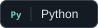
  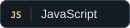
  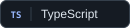
  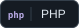
  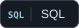
  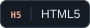
  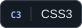
</p>

<h4>Frameworks &amp; runtime</h4>

<p>
  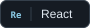
  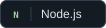
  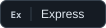
  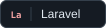
  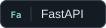
  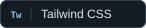
</p>

<h4>Libraries</h4>

<p>
  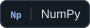
  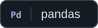
  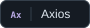
</p>

<h4>Databases</h4>

<p>
  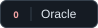
  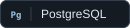
  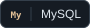
</p>

<h4>Development &amp; delivery</h4>

<p>
  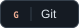
  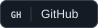
  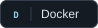
  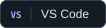
  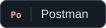
  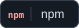
  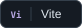
  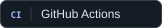
  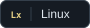
</p>

<h4>Currently exploring</h4>

<p>LLM applications · Generative AI · RAG · Vector databases · AI agents · Prompt engineering</p>

<h3>A few things I'm building</h3>

<ul>
  <li><a href="https://github.com/MohamedRF/VLMux"><strong>VLMux</strong></a> — Giving vision-language models a computer. <sub>In development.</sub></li>
  <li><a href="https://github.com/MohamedRF/DBMux"><strong>DBMux</strong></a> — Connecting AI coding agents to Oracle and PostgreSQL.</li>
  <li><a href="https://github.com/MohamedRF/arc_to_zen"><strong>Arc to Zen</strong></a> — Moving your browser workspace from Arc to Zen on macOS.</li>
</ul>

<h3>🐍 A snake eating my contributions</h3>

<p align="center">
  <picture>
    <source media="(prefers-color-scheme: dark)" srcset="https://raw.githubusercontent.com/MohamedRF/MohamedRF/output/github-snake-dark.svg" />
    <source media="(prefers-color-scheme: light)" srcset="https://raw.githubusercontent.com/MohamedRF/MohamedRF/output/github-snake.svg" />
    
  </picture>
</p>

<p align="center"><sub>One contribution at a time. One hungry snake.</sub></p>

<hr />

<p align="center">
  <a href="https://buymeacoffee.com/mohamedrf">☕ Buy me a coffee</a><br />
  <sub>If my work helps you, you can support what I build next.</sub>
</p>

<p align="center">
  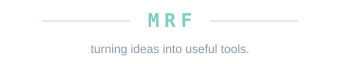
</p>
