<p align="center">
  
</p>

<h1 align="center">Hi, I'm Mohamed Rasik Farid 👋</h1>

<p align="center">
  <strong>Software Architect</strong><br />
  <sub>Enterprise systems · Full-stack development · Pursuing AI engineering</sub>
</p>

<p align="center">
  
</p>

<p align="center">
  
</p>

<p align="center">
  
</p>

<p align="center">
  <a href="https://www.linkedin.com/in/mohamedrasikfarid/">LinkedIn ↗</a>
  &nbsp;·&nbsp;
  <a href="mailto:mohamedrasikfarid.tech@gmail.com">Email ↗</a>
  &nbsp;·&nbsp;
  <a href="https://github.com/MohamedRF?tab=repositories">My projects ↗</a>
  &nbsp;·&nbsp;
  <a href="https://github.com/MohamedRF?tab=stars">Things I find interesting ↗</a>
</p>

<p align="center"><sub><strong>Now:</strong> Building VLMux · DBMux &nbsp;·&nbsp; <strong>Exploring:</strong> LLM applications · RAG · AI agents</sub></p>

<p align="center">
  <a href="https://buymeacoffee.com/mohamedrf"></a>
</p>

<details>
  <summary>Contents</summary>

  <p align="center">
    <a href="#about">About</a> ·
    <a href="#stack">Stack</a> ·
    <a href="#activity">Activity</a> ·
    <a href="#snake">Snake</a>
  </p>
</details>

<hr />

<p id="about"></p>

<h3>About me · <code>profile.rs</code></h3>

```rust
#[derive(Debug)]
struct SoftwareArchitect {
    name: &'static str,
    focus: &'static str,
    background: &'static [&'static str],
    strengths: &'static [&'static str],
    exploring: &'static [&'static str],
    github: &'static str,
    linkedin: &'static str,
    email: &'static str,
}

fn main() {
    let me = SoftwareArchitect {
        name: "Mohamed Rasik Farid",
        focus: "Enterprise architecture → AI engineering",
        background: &[
            "Enterprise web apps", "Digital governance",
            "Academic systems", "Payments & cloud services",
        ],
        strengths: &[
            "Full-stack development", "API & system integration",
            "Database architecture", "Technical leadership",
        ],
        exploring: &[
            "LLM applications", "RAG & vector databases",
            "AI agents", "Prompt engineering & automation",
        ],
        github: "github.com/MohamedRF",
        linkedin: "linkedin.com/in/mohamedrasikfarid",
        email: "mohamedrasikfarid.tech@gmail.com",
    };

    println!("{me:#?}");
}
```

> Software Architect building enterprise systems across web, payments, and governance.
> Currently moving into AI engineering — LLM applications, RAG, and AI agents.
> I like turning complex systems into useful tools, then sharing what I build.

<p id="stack"></p>

<h3>Languages, frameworks &amp; tools</h3>

<h4>Languages</h4>

<p>
  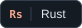
  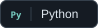
  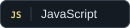
  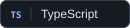
  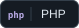
  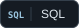
  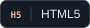
  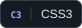
</p>

<h4>Frameworks &amp; runtime</h4>

<p>
  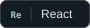
  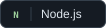
  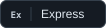
  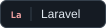
  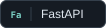
  
</p>

<h4>Libraries</h4>

<p>
  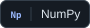
  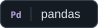
  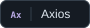
</p>

<h4>Databases</h4>

<p>
  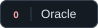
  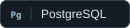
  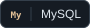
</p>

<h4>Development &amp; delivery</h4>

<p>
  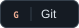
  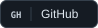
  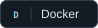
  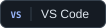
  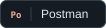
  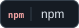
  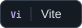
  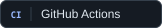
  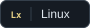
</p>

<h4>Currently exploring</h4>

<p>LLM applications · Generative AI · RAG · Vector databases · AI agents · Prompt engineering</p>

<details>
  <summary>Stack as text (for screen readers / search)</summary>

  <ul>
    <li><strong>Languages:</strong> Rust · Python · JavaScript · TypeScript · PHP · SQL · HTML5 · CSS3</li>
    <li><strong>Frameworks &amp; runtime:</strong> React · Node.js · Express · Laravel · FastAPI · Tailwind CSS</li>
    <li><strong>Libraries:</strong> NumPy · pandas · Axios</li>
    <li><strong>Databases:</strong> Oracle · PostgreSQL · MySQL</li>
    <li><strong>Dev &amp; delivery:</strong> Git · GitHub · Docker · VS Code · Postman · npm · Vite · GitHub Actions · Linux</li>
  </ul>
</details>

<p id="activity"></p>

<h3>📊 GitHub activity</h3>

<p align="center">
  
  
</p>

<p id="snake"></p>

<h3>🐍 A snake eating my contributions</h3>

<p align="center">
  <picture>
    <source media="(prefers-color-scheme: dark)" srcset="https://raw.githubusercontent.com/MohamedRF/MohamedRF/output/github-snake-dark.svg" />
    <source media="(prefers-color-scheme: light)" srcset="https://raw.githubusercontent.com/MohamedRF/MohamedRF/output/github-snake.svg" />
    
  </picture>
</p>

<p align="center"><sub>One contribution at a time. One hungry snake.</sub></p>
<!-- If this image is blank, the snake hasn't been generated yet — run Actions → Generate contribution snake once. -->

<p align="center">
  
</p>

<p id="support"></p>

<p align="center">
  
</p>

<h3 align="center">☕ Support my work</h3>

<p align="center">
  <strong>If my work helps you, a coffee keeps what I build next coming.</strong><br />
  <sub>Open source, experiments, and tools — funded by readers like you.</sub>
</p>

<p align="center">
  <a href="https://buymeacoffee.com/mohamedrf"></a>
</p>

<p align="center">
  <a href="https://buymeacoffee.com/mohamedrf"></a>
</p>

<hr />

<p align="center">
  <sub>Thanks for stopping by. Let's build something useful.</sub><br />
  <sub><a href="https://www.linkedin.com/in/mohamedrasikfarid/">Connect on LinkedIn ↗</a> · <a href="mailto:mohamedrasikfarid.tech@gmail.com">Email me ↗</a></sub>
</p>

<p align="center">
  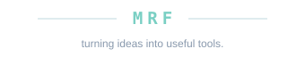
</p>

<p align="center">
  <sub>Layout inspired by <a href="https://github.com/durgeshsamariya/awesome-github-profile-readme-templates/blob/master/templates/Abdalrahman-Alhamod.md">Abdalrahman Alhamod's profile template</a> · Code-style bio inspired by <a href="https://github.com/durgeshsamariya/awesome-github-profile-readme-templates/blob/master/templates/rednafi.md">rednafi</a>.</sub>
</p>
